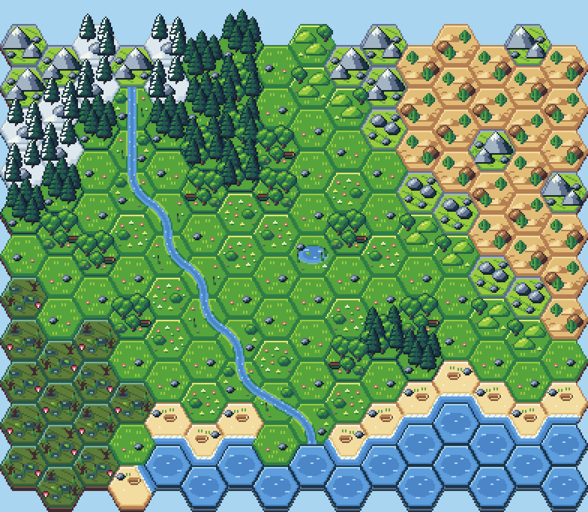
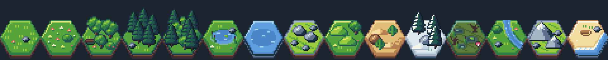

# HexCiv

HexCiv is a hex-map game about building with terrain and water. This repository holds its art: a hand-drawn,
flat-top hex tile set in the **bright tiles** style, the map it builds, the rules the art follows, and the
explorations that led to it.



## Quick start

No build step and no dependencies beyond Node (for the tools).

| Do this | Command |
|---|---|
| Play the prototype | Open `play.html` in a browser |
| Play prototype v2 (frozen) | Open `archive/6-prototype-v2/play.html` |
| Play prototype v1 (frozen) | Open `archive/5-prototype-v1/play.html` |
| View the map, tile set and checks | Open `index.html` in a browser |
| Run the art checks (also runs in CI) | `node tools/check.js` |
| Re-export the PNGs after changing art | `node tools/export.js` |

## What's here

```
index.html              Tile viewer: world map with hover tooltips, the tile set, the five-tile isle, the checks
src/tiles.js            The tile engine: grid, palette, every sprite, every tile layout, maps, checks
src/viewer.js           Viewer page logic
play.html               Prototype v3, Healing the Land: soil, food and water per tile, plans, crews, the dock and the trader
src/game.js             Prototype game logic, the ruined map and its art, and the HUD
src/icons.js            Pixel-art HUD and tech tree icons
art/tiles/*.png         One PNG per terrain, 32x48 at 1x
art/tilesheet.png/json  All terrains in one strip, with the order and cell metrics
art/maps/*.png          The composed maps at 1x
tools/check.js          Art checks: tessellation, lone pixels, sprite placement, river continuity
tools/export.js         Regenerates every PNG in art/ and docs/images/
tools/png.js            Tiny dependency-free PNG writer
docs/art-style.md       The style guide: grid, palette, light, outlines, sprites, terrains, checks
docs/game-design.md     The game concept and what each terrain is for
docs/art-history.md     How the style was found, step by step
archive/                Earlier explorations, kept runnable (see docs/art-history.md)
archive/5-prototype-v1/ Prototype v1 frozen: the clean Verdant Reach map and its game
archive/6-prototype-v2/ Prototype v2 frozen: Restore the Valley, workers posted on tiles by hand
```

## The tile set



Fifteen terrains: grassland, flower meadow, oak grove, pine stand, deep forest, pond, lake, boulder field, rolling
hills, desert, tundra, swamp, river, mountains and beach. Rivers join up across tiles, and beaches flood only the
edges that face the lake. See [docs/art-style.md](docs/art-style.md) for the full spec.

## Credits

The grid format follows The Clover Patch's Fantasy Hex Tiles (CC-BY 4.0): the same 32×28 flat-top hexes. No art from that pack is used: every sprite here is drawn new.
Early palette and depth work follows Slynyrd's *Pixelblog 62: Landscape Backgrounds*.
